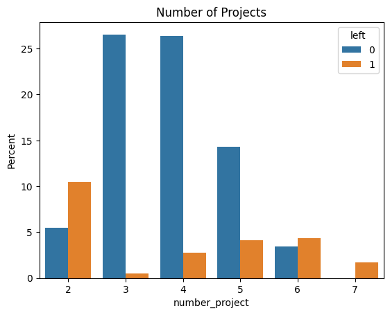
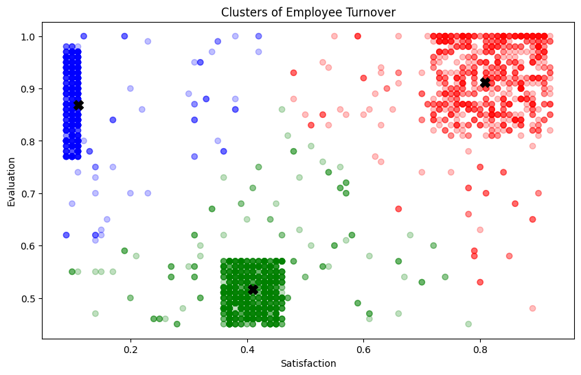
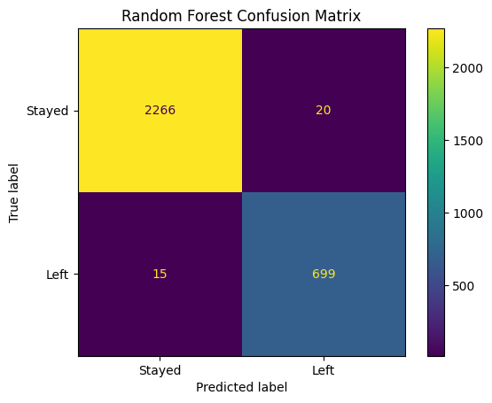
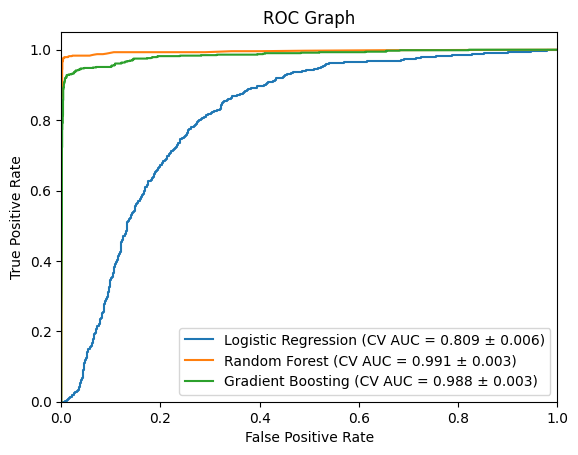
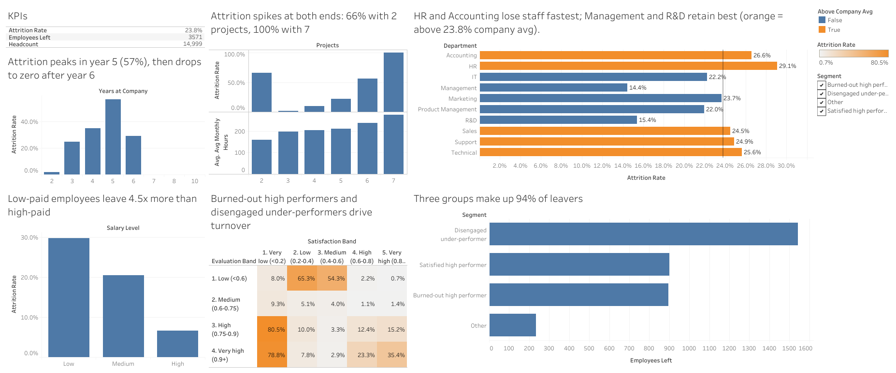

# Employee Attrition Analysis

**Why are employees leaving, and who is likely to leave next?**

This project analyzes 14,999 HR records (23.8% of employees left), segments the employees who left into behavioral groups, and builds a classifier that flags at-risk employees so HR can target retention efforts.

**Tools:** SQL (SQLite: CTEs, window functions, joins), Tableau, Python, pandas, seaborn, scikit-learn, imbalanced-learn (SMOTE), K-Means

| Part | What it does |
|---|---|
| [`sql/`](sql/) | Loads the data into a SQLite database and answers 10 business questions in SQL |
| [`tableau/`](tableau/) | Tableau-ready extract (built in SQL) and an interactive dashboard |
| [`employee_attrition_analysis.ipynb`](employee_attrition_analysis.ipynb) | EDA, clustering, and predictive models in Python |

## Key findings

**1. Workload drives turnover at both extremes.** Employees with 2 projects (likely under-utilized) and 6–7 projects (likely overworked) leave at much higher rates than those with 3–5.



**2. Employees who left fall into three distinct groups** (K-Means on satisfaction × evaluation):

| Cluster | Profile | Likely cause |
|---|---|---|
| 🔵 High evaluation, low satisfaction | Strong performers who are unhappy | Burnout, lack of growth, management issues |
| 🟢 Low evaluation, low–medium satisfaction | Under-performers | Poor role fit, lack of support |
| 🔴 High evaluation, high satisfaction | Strong, happy performers | Outside offers, life changes |



**3. Random Forest identifies 98% of leavers.** It was evaluated on 3,000 held-out employees who were never seen in training.

| Model | Accuracy | Recall (Left) | Precision (Left) | 5-fold CV AUC |
|---|---|---|---|---|
| Logistic Regression | 75.2% | 0.75 | 0.49 | 0.809 ± 0.006 |
| **Random Forest** | **98.8%** | **0.98** | **0.97** | **0.991 ± 0.003** |
| Gradient Boosting | 96.3% | 0.94 | 0.91 | 0.988 ± 0.003 |

Recall was the priority metric: missing an employee who is about to leave (a false negative) costs more than an unnecessary check-in.

 

**4. Risk zones for action.** Employees are bucketed by predicted probability of leaving (Safe / Low / Medium / High). Each zone gets its own retention playbook, ranging from routine monitoring up to retention bonuses, flexible work, and career development for high-risk employees.

## SQL analysis

[`sql/attrition_queries.sql`](sql/attrition_queries.sql) answers 10 business questions using aggregations, `CASE` segmentation, `JOIN`s, CTEs, subqueries, and window functions (`RANK()`, `SUM() OVER ()`). Each result is saved to [`sql/results/`](sql/results/).

| Question | Finding |
|---|---|
| Overall attrition | **23.8%** of 14,999 employees left |
| By department | HR (29.1%) and Accounting (26.6%) are highest; Management (14.4%) and R&D (15.4%) lowest. Sales accounts for 28% of all leavers |
| By salary | Low pay 29.7% vs medium 20.4% vs high 6.6%: **low-paid employees leave 4.5× more often** |
| By workload | 65.6% of employees with 2 projects left, and **100% with 7**; 3 projects is the sweet spot (1.8%) |
| By tenure | Attrition peaks in **year 5 (56.6%)**; nobody with 7+ years left |
| Leaver segments | Three groups make up **94% of leavers**: disengaged under-performers (43%), burned-out high performers (25%; 262 hrs/month, 5.8 projects), and satisfied high performers (25%) |
| Workload groups | Under-utilized 84.0% and overworked 36.3% vs balanced **7.5%** |
| Promotions | Promoted employees leave at 6.0% vs 24.2% for others |
| High-performer flight | Technical loses top performers 3.7 points above the company average |

Example: ranking departments against the company average with window functions:

```sql
SELECT
    department,
    ROUND(100.0 * AVG(left_company), 1)                             AS attrition_rate_pct,
    ROUND(100.0 * (AVG(left_company)
          - (SELECT AVG(left_company) FROM employees)), 1)          AS vs_company_avg_pts,
    RANK() OVER (ORDER BY AVG(left_company) DESC)                   AS attrition_rank,
    ROUND(100.0 * SUM(left_company) / SUM(SUM(left_company)) OVER (), 1) AS share_of_all_leavers_pct
FROM employees
GROUP BY department
ORDER BY attrition_rate_pct DESC;
```

## Tableau dashboard



The dashboard is built from [`tableau/employee_attrition_tableau.csv`](tableau/employee_attrition_tableau.csv), an employee-level extract created by [`sql/tableau_extract.sql`](sql/tableau_extract.sql). It includes KPI tiles, attrition by department against a company benchmark (LOD expression), a workload curve, a satisfaction × evaluation heat map, and tenure, salary, and segment breakdowns, with cross-filtering by department. Build steps: [`tableau/TABLEAU_GUIDE.md`](tableau/TABLEAU_GUIDE.md).

## Methodology notes

- The train/test split happens **before** SMOTE oversampling, so the test set contains only real employees.
- Cross-validation uses an `imblearn` pipeline so SMOTE runs inside each fold and never leaks synthetic rows into validation data.
- Categorical features (`department`, `salary`) are one-hot encoded.

## Run it

```bash
pip install -r requirements.txt

# SQL analysis (SQLite is built into Python, so there's nothing else to install)
python sql/load_data.py       # builds sql/hr.db
python sql/run_queries.py     # runs all queries, writes sql/results/ and the Tableau extract

# Python / machine learning
jupyter notebook employee_attrition_analysis.ipynb
```

**Data:** `HR_comma_sep.csv`, the HR Analytics employee attrition dataset (14,999 rows, 10 columns), included in this repo.
